# OpenCode + DeepSeek V4.1 Flash + Jev

Docker-based setup. All project code stays inside this repository.

## Glossary — acronyms and rule citations

**Rule citations.** A rule is cited by **name, number, and link** — for example
[RULE #67 — Telemetry/visualization doctrine](RULES.md#rule-67) — never by a
bare number. [`RULES.md`](RULES.md) is the source of truth; each anchor lands on
the rule's row and carries its enforcement text plus evidence of use.

**Acronyms** used in this document, with their expansions (each is also spelled
out at its first prose use where the abbreviation could be ambiguous):

| Acronym | Expansion |
|---|---|
| API | Application Programming Interface |
| ARIA | Accessible Rich Internet Applications (W3C specification) |
| ASK | Ask-tier: a model policy verdict that requires human approval |
| BM25 | Best Matching 25 (a ranking function for full-text search) |
| CA | Certificate Authority |
| CDP | Chrome DevTools Protocol |
| CLI | Command-Line Interface |
| CSV | Comma-Separated Values |
| DB | Database |
| DNS | Domain Name System |
| DOM | Document Object Model |
| ECC | The external ECC skills catalog (`github.com/affaan-m/ECC`) |
| FTS5 | Full-Text Search version 5 (SQLite extension) |
| HTTP / HTTPS | Hypertext Transfer Protocol / HTTP Secure |
| JS | JavaScript |
| JSON | JavaScript Object Notation |
| LAN | Local Area Network |
| MCP | Model Context Protocol |
| NSS | Network Security Services (Mozilla certificate store) |
| OCR | Optical Character Recognition |
| REST | Representational State Transfer |
| RFC | Request for Comments (IETF standards document) |
| SAN | Subject Alternative Name (TLS certificate field) |
| SQL | Structured Query Language |
| SSE | Server-Sent Events |
| TLS | Transport Layer Security |
| TTL | Time To Live |
| TUI | Terminal User Interface |
| UI / UX | User Interface / User Experience |
| UID | User Identifier |
| URL | Uniform Resource Locator |
| WAI | Web Accessibility Initiative (W3C) |
| WAL | Write-Ahead Logging (SQLite journal mode) |
| WCAG | Web Content Accessibility Guidelines (W3C) |

## Status — where we are, how we got here, next steps (2026-10-16)

### How we got here
A dockerized OpenCode + DeepSeek + Jev stack with a read-only `:5099` dashboard,
grown a fail-closed monitoring family (**sentinel T1–T7**, cursor-bounded,
de-cry-wolfed via stable per-incident ledger keys), a zero-dependency
**Chrome DevTools Protocol (CDP)** browser path
([**`cdp-tab.mjs`**](scripts/cdp-tab.mjs); see
[RULE #62 — Drive a live browser over CDP, never X11 automation](RULES.md#rule-62)
and [RULE #64 — Benchmark-informed browser-driver choice with failover](RULES.md#rule-64)),
a user-experience (**UX**) gate ([**`ux-smoke.py`**](scripts/ux-smoke.py),
**Document Object Model (DOM)** + local **Optical Character Recognition (OCR)**
`--vision`) with a **light theme** so tesseract can read
([RULE #65 — Prefer local OCR over a paid cloud vision-language model](RULES.md#rule-65)
and [RULE #66 — Light theme so local OCR can read the screen](RULES.md#rule-66)),
and the telemetry doctrine
([RULE #67 — Telemetry/visualization doctrine: declarative, database-driven,
drill-down-native](RULES.md#rule-67) +
`.opencode/skills/telemetry-dashboard`: Grafana/Vega-Lite/TanStack; not Flutter).
Fixed the served-page defects the operator hit (time-zone labels, poll-loop
freeze, STALE-revision banner, empty Session-detail, inline-expand collapse,
buried Gantt). Full causal chain in `HANDOFF.md`.

### Where we are
- Sentinel **T1–T7**; ledger deduped; DB-only **digests** auto-written on a trip;
  alerting now **fires** (`sentinel.sh` → `notify.sh` when `NOTIFY_WEBHOOK` is
  set; the unit loads `.env.local`).
- Dashboard: **clickable Gantt** (bar → in-page span timeline with per-part ms),
  a **Flags** panel (bottlenecks · cost · slowdowns · stalls, clickable), a
  **projected-schedule estimate Gantt**, **trends** (cost/sessions per day), a
  **light theme**, and **snapshot→deltas Server-Sent Events (SSE)**
  (`/api/stream`) instead of polling. `/api/board` is **offloaded** to
  `query-worker.mjs`.
- Browser: `cdp-tab.mjs` (Node) + `browser_bench.py` failover; a **semantic
  beforeTool guard** (`guard-classify.py`) layered into `blacklist-guard.js`.
- Ops: `web-restart.sh` kills all dashboard pids before relaunch (no more `:5099`
  down-race); `host-path-probe.sh` breaks the hop into Domain Name System
  (DNS) / Transport Layer Security (TLS) / time-to-first-byte (TTFB);
  `tui-audit.py` audits a **terminal user interface (TUI)** session causally;
  and the browser/telemetry rules
  [#62 — drive a live browser over CDP](RULES.md#rule-62) ·
  [#63 — UI-only consent steps](RULES.md#rule-63) ·
  [#64 — benchmark-informed browser drivers](RULES.md#rule-64) ·
  [#65 — local OCR over cloud vision](RULES.md#rule-65) ·
  [#66 — light theme for OCR](RULES.md#rule-66) ·
  [#67 — telemetry/visualization doctrine](RULES.md#rule-67) ·
  [#68 — Claude is ASK-tier](RULES.md#rule-68) ·
  [#69 — durable-harness doctrine](RULES.md#rule-69)
  plus the `telemetry-dashboard` skill.
- **Host-only, pending:** the CDP-bound screenshot/video capture (needs Chrome on
  `:9222` or `playwright install chromium`), the host browser-venv wiring, and
  standing up Grafana.

### Next steps (in order)
1. **Capture the README media** — `python3 scripts/panels-tour.py` (per-panel
   screenshots + a `.webm` tour); needs a launchable chromium (host).
2. **Host browser stack** — point `ux-smoke.py` / `browser_bench.py` at the host
   venv (`/home/owner/.venvs/browser`) so the vision/failover legs have a home.
3. **Host path** — the probe shows the hop is **TLS-dominated**; cut the caddy
   handshake cost (Hypertext Transfer Protocol version 2, HTTP/2, keep-alive /
   CPU contention) or bypass it.
4. **Grafana + SQLite** (below) as the non-bespoke ops view.

### Optional: a hosted-grade ops view (Grafana + SQLite)
`docker/docker-compose.observability.yml` runs Grafana with the two SQLite
stores mounted read-only and a provisioned `frser-sqlite-datasource`. On the
host: `docker compose -f docker/docker-compose.observability.yml up -d` → open
`http://127.0.0.1:3000` (anonymous viewer on localhost). Use it for metrics,
**alerting**, **annotations**, and **saved views** instead of hand-rolling
panels ([RULE #67 — Telemetry/visualization doctrine](RULES.md#rule-67));
`:5099` stays the in-app view. Verify the plugin id/schema on first run.

### Screenshots (light theme)

Regenerate every panel + a short `.webm` tour with the scripted capture:
`python3 scripts/panels-tour.py` (needs a launchable chromium —
`playwright install chromium`; the sandbox lacks the system libs, so run it on
the host). It writes
`docs/ux/status-{home,overview,board,trends,signals,patterns}.png` and
`docs/ux/tour.webm`, shrinking each shot under the 150 KiB image budget (from
the original, so it never double-shrinks) and recording a separate 960x540 tour
under the 2 MiB video budget. `python3 scripts/panels-tour.py --check` lists any
expected shot that is still missing (it reports, it does not fake a pass).

Dashboard home — **Flags** (bottlenecks · cost · slowdowns · stalls), sessions
with time-zone-labelled times, cost, live activity:

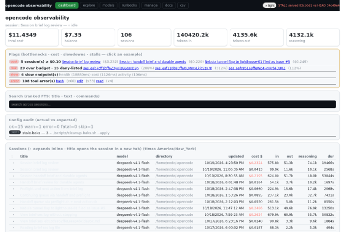

`/explore ▸ overview` — search everything + the compact sessions table:

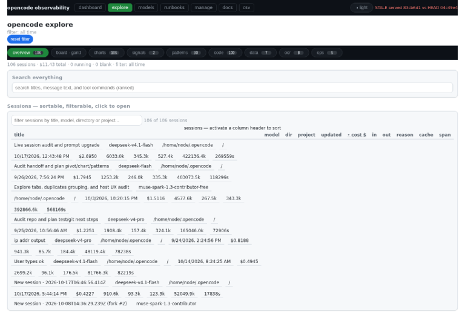

`/explore ▸ board · gantt` — Kanban (pending / in-progress / completed) + the
**clickable Gantt** + the **projected-schedule estimate**:

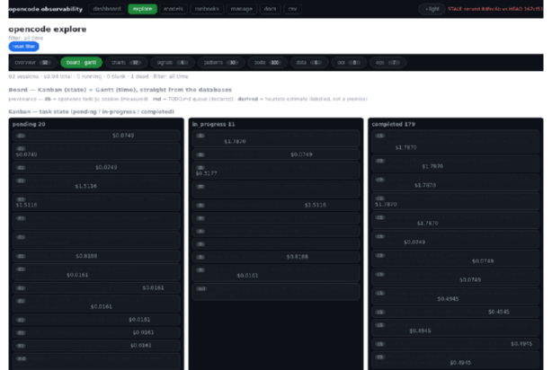

`/explore ▸ charts` — **trends**: sessions & cost per day:

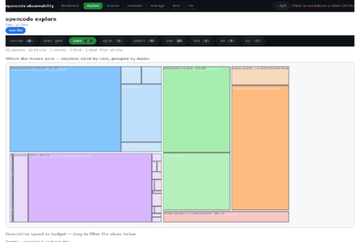

`/explore ▸ signals` — **session health** (stalled / blank turns) + the guard
panel; a health finding drills into the session detail:

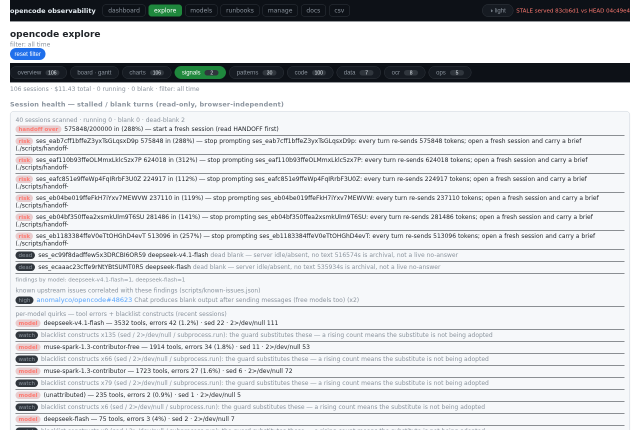

`/explore ▸ patterns` — recurring tool-sequence n-grams + known fixes; each
bigram drills into an example session:

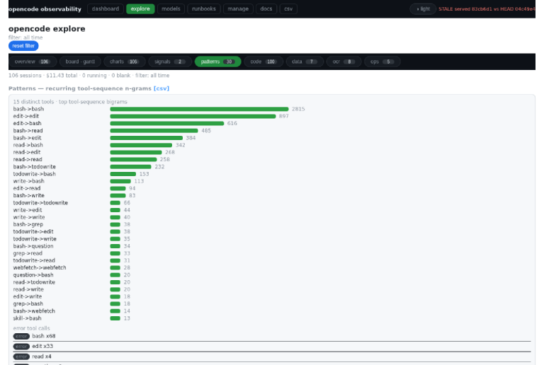

A short click-through tour (960x540, six panels):
[`docs/ux/tour.webm`](docs/ux/tour.webm).

Clicking a Gantt bar drills into that session's **timeline in-page** (`detail()`):

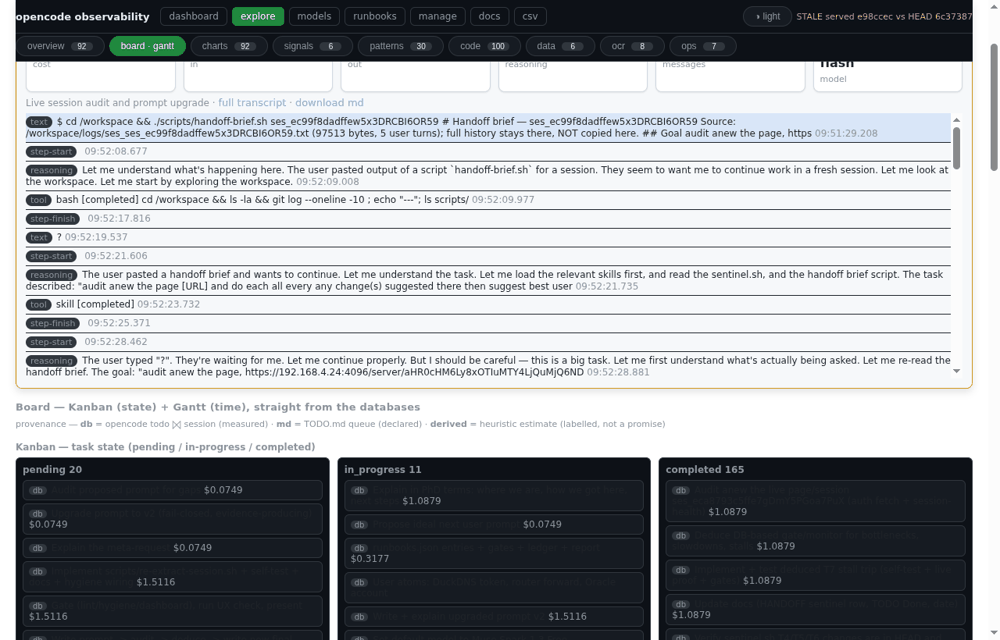

See [RULE #62 — drive a live browser over CDP](RULES.md#rule-62) through
[RULE #67 — telemetry/visualization doctrine](RULES.md#rule-67),
`.opencode/skills/telemetry-dashboard`, `HANDOFF.md`, and `TODO.md` for the
full queue.

## Prerequisites
- Docker Engine (daemon reachable by current user)
- GitHub Command-Line Interface (`gh`), authenticated
- DeepSeek Application Programming Interface (API) key (prefix sk-)
  https://platform.deepseek.com/api_keys
- Jev API key (prefix apikey_)
  https://console.typesafe.ai/keys

## Quick Start
cd docker
./build.sh
./run.sh

Keys are cached in ../.env.local (mode 0600, gitignored).

## Vision / image input
DeepSeek V4.1 Flash natively ingests images. `opencode.json` declares this
(`attachment: true` + `modalities.input: ["text","image"]`), so OpenCode
sends screenshots to DeepSeek directly — no separate provider needed.
(OpenCode gates image input on the model's declared `modalities`; a custom
provider entry without that declaration is treated as text-only.)

If a model rejects an image anyway, read it locally instead:

    ./scripts/ocr-image.sh <image.png>      # tesseract Command-Line Interface (CLI), tesseract.js, or PaddleOCR
    ./scripts/ocr-image.sh --check          # report which engine is available

Each run is persisted to data/observability/ocr_run and surfaced in the
dashboard: /api/ocr lists runs, /api/export/ocr downloads Comma-Separated
Values (CSV), and the OCR
text is folded into /api/semantic so the search box finds screenshots too.

The engines match github.com/swipswaps/receipts-ocr: tesseract.js (browser)
and PaddleOCR (backend/app.py). **tesseract.js + pngjs are pinned in
package.json** and installed via `npm install`, so it reads screenshots out
of the box with no apt/pip and no API model; oversized images are
downscaled before OCR so very tall screenshots don't stall. `tesseract-ocr`
is also baked into the image. PaddleOCR is available with
`pip install paddleocr paddlepaddle`.

## Linting
    ./scripts/lint.sh

Static gate over the repo: `bash -n` on every script, `shellcheck` (baked
into the image), `node --check` on the JavaScript (JS) (including
`.opencode/plugins/*.js`), `py_compile` on the Python, a `subprocess.run`
check, a `scan-constraints.py` pass (code vs string/comment) over
`scripts/*.sh`, and a RULES grep (no `sed`, no `2>/dev/null`).

Every check line carries `ms=<wall time since the previous check>` and the
slowest check is named at the end — the actionable signal that a bare timeout
is not. `shellcheck` runs in parallel (one background job per file); serially
it was ~40s and was what pushed the combined gate past its budget.
`test-dashboard.sh` already runs `lint.sh` and `test-hygiene.sh`, so run it
alone rather than chaining all three (chaining doubles the lint cost).

If tool output looks empty, suspect suppressed streams: the blacklist guard
exists so `2>/dev/null` cannot hide the diagnostic. Audit with
`./scripts/audit-tool-calls.py` — it reports exactly which commands hid stderr.

## Blacklist enforcement (three layers)
The blacklist (`sed`, `2>/dev/null`, `subprocess.run`, `rm -rf`, `echo`) is
enforced at three points: files (`lint.sh` + `scan-constraints.py` fail the
build), runtime detection (`scripts/audit-tool-calls.py` reports what the agent
ran), and runtime prevention (`.opencode/plugins/blacklist-guard.js`, auto-loaded
from the plugin dir — no `opencode.json` entry, which would double-load it).
The guard hooks `tool.execute.before` and acts on the agent's own bash commands
during "Thinking" before they run: **block** (`sed`/`rm -rf`/`subprocess.run`,
throws with the substitute), **fix** (`2>/dev/null` — the redirect is removed so
stderr, the proof, reaches the result), **warn** (`echo`). Matching is
quote-aware (`grep 'sed'` passes). Policy: `OPENCODE_BLACKLIST_GUARD` =
unset/`block` | `warn` | `off`; reload with
`docker compose -f docker/docker-compose.yml restart opencode-web`. Full detail:
HANDOFF "Hygiene enforcement"; unit test: `blacklist-guard-self-test.mjs`.

## Writing prompts
A prompt is an interface contract: state the falsifiable outcome, the
constraints, and the evidence. This keeps the work checkable without
re-reading the whole chat — which is also what keeps context (and cost)
down. Template:

    ## Objective
    <one sentence: the falsifiable outcome>
    ## Context (read first)
    HANDOFF.md, RULES.md, README.md; <specific files / endpoints>
    ## Constraints (non-negotiable)
    RULES.md; blacklist enforced by .opencode/plugins/blacklist-guard.js;
    read-only over data/opencode/opencode.db.
    ## Deliverable
    <exact artifacts>
    ## Acceptance criteria (each independently checkable)
    - [ ] `<command>` prints `<expected>`
    - [ ] `./scripts/<gate>.sh` exits 0
    ## Evidence (paste back)
    gate outputs, `git diff --stat`, exact commands.
    ## Out of scope
    <what not to touch>

`./scripts/prompt-lint.py --prompt "..."` classifies a prompt, fuzzy-matches
it against past prompts, surfaces recurring errors, and flags blacklist
mentions / secrets / vagueness / missing acceptance criteria. Use it before
sending a large request.

To use a *different* vision model (e.g. Muse Spark via OpenCode Zen), on a
host terminal with browser access run `opencode`, `/connect` → OpenCode Zen,
`/models`. Avoid pasting secret-bearing screenshots to Free-tier models.

## Telemetry policy
Smoke tests stream stdout and stderr live via process substitution
(> >(tee file)). No buffering. The user sees the model's response
as it arrives. The safety timeout (120s) fires only if the process
genuinely makes no progress.

## Smoke test methodology
opencode 1.18.31 exits non-zero after a successful non-TTY (teletypewriter /
terminal) response.
The staging script asserts on response text ("OK") instead of exit
code. Elapsed time and exit code are reported for diagnostic purposes
but do not determine pass/fail.

## UID (User Identifier) handling
Container runs with --user $(id -u):$(id -g). /home/node is chmod 777
at build time.

## Secrets hygiene
- Keys never appear on docker CLI argv (bare -e VAR).
- curl Authorization headers written to mode-0600 temp files.
- .env.local is gitignored and mode 0600.
- The web user interface (UI, port 4096) requires OPENCODE_SERVER_PASSWORD; web.sh
  refuses to start without it (pass --insecure to override).
- Port 4096 is bound to 127.0.0.1 only (loopback). The password is the single
  gate, so it must not be the only thing between the service and a Local Area
  Network (LAN).
  Widening it is a three-part change — rotate first, widen only the publish
  line, then firewall the CIDR; see HANDOFF "Exposing 4096 to the LAN". Never
  widen the port alone.
- data/opencode/ and data/observability/ are gitignored, so session text and
  telemetry are never pushed. Session EXPORTS (/api/export/session, the sessions
  CSV) are **redacted** at the boundary by `scripts/redact.mjs` (key shapes and
  `NAME=value` assignments), so a leaked value in the transcript does not leave
  the system; `node scripts/redact.mjs` also filters stdin.
- Stale *.bak.* snapshots (including old .env.local.bak.* key copies)
  are removed with ./scripts/cleanup-baks.sh --apply.

## Logs
Full staging output captured to ../staging.log.

## Verification (V1 command surface)
opencode V1 has no "mcp list" subcommand. **Model Context Protocol (MCP)**
servers are read from opencode.json. The staging script verifies:
- opencode --help loads the binary
- opencode.json parses and lists mcp.servers keys via python3
- the image builds
- DeepSeek smoke test returns response text "OK"
- plugin list returns output (exit code informational)

## Cost monitoring
    ./scripts/cost.sh
    ./scripts/cost-bottlenecks.sh --top N

Prints DeepSeek cost accounting from two sources: the opencode database
(per-session USD cost and input/output/reasoning/cache tokens) and the
provider balance endpoint (https://api.deepseek.com/user/balance). The
API key is read from .env.local and never printed. Note that jev-review
MCP calls are billed separately by TypeSafe and do not appear in the
DeepSeek balance.

Model choice is the dominant cost lever. Keep the agent on `deepseek-flash`
(the opencode.json default) or a free model: a non-flash reasoning model
(e.g. `deepseek-v4-pro`) re-prices the whole context every turn — 2.9x the
input price. Three long "audit" sessions on v4-pro were ~94% of lifetime
spend at their peak; the live share drifts, so read it from
`cost-bottlenecks.sh` "model mix check" (or the /models page), not from a
hard-coded number. The ceiling is `models.policy.json`.

## Live activity ("thinking")
    ./scripts/thinking.sh            (terminal)
    ./scripts/dashboard.sh           (web: http://127.0.0.1:5099)

thinking.sh tails the opencode database and prints what the agent is doing
in real time: step boundaries, tool calls (with running/completed/error
state and the command), reasoning text, and answer text. dashboard.sh is
the same data in a read-only browser view, with cost cards and the todo
list. Both poll the database (2s) and run in the container and on the
host. Predictive cost: ./scripts/cost.sh --estimate IN OUT [REASONING].

The dashboard drills down. Click a session row to see its detail panel
(cost, tokens, span, message count) and the ordered tool/reasoning/text
parts. Each detail panel offers a per-session chat-history download as
txt, md, or json (/api/export/session). The search box runs ranked
full-text search across every session — text, reasoning, and tool
commands — via an in-memory SQLite **Full-Text Search version 5 (FTS5)** /
**Best Matching 25 (BM25)** index (/api/semantic).
http://127.0.0.1:5099/runbooks lists the operational runbooks (host vs
container) with copy buttons; ./scripts/runbook.sh runs them as a menu.
scripts/runbooks.json is the single source for both — add entries there, not
in dashboard.mjs. Entries include the blacklist guard (pause/resume), balance
top-up, and the log miner below. Note the dashboard on :5099 runs inside the
opencode-web container (web-entrypoint.sh starts it), so restarting that
container takes :5099 down for a few seconds.

## Learning from the logs
    ./scripts/issue-solutions.py [--top N]        # issues -> proven fixes
    ./scripts/logs.sh [--source S] [--since MIN]  # raw telemetry

Free, local, no model call. `issue-solutions.py` reads the chat database
read-only and pairs each error tool call with the next completed call in the
same session, then ranks the recurring (issue, fix) pairs with the log
evidence. Example output: "JEV_API_KEY rejected" x8 -> the env/`.env.local`
checks that fixed it; "Could not find oldString" x4 -> the grep that located
the real text. Run it with `--write` to persist
data/observability/solutions.json, served at /api/solutions and shown as
"known fixes" on /explore ▸ patterns.

`logs.sh` is the raw layer behind that: `--source guard` (every blacklist
block/fix/warn the agent's own "Thinking" triggered, from
data/observability/guard.log), `error` (tool failures + stack trace),
`event` (the opencode event bus), `app` (~/.local/share/opencode/log/
opencode.log), `system` (docker logs; host only), `packet` (the exact
tcpdump command). Use it when a step is slow or output looks empty — the
`ms=` telemetry names the slow check; `logs.sh` shows why.

## Repo code index
    ./scripts/code-index.py            # assemble + flag the repo's own code
    ./scripts/code-index.py --flags    # file:line flag list
    ./scripts/code-index.py --grep RE  # files whose path/symbols match

Indexes the repo's own code/config/docs (per-file metadata + top-level symbols)
into data/observability/code.db and flags blacklist patterns plus TODO/FIXME —
so code can be inspected alongside the chat database and, later, classified by
Jev/Laya/DeepSeek. Surfaced at /api/code and /explore ▸ code.

## Duplicate prompts (dedup / semantic cache)
`prompt-lint.py` flags a prompt that is >= 0.9 similar to a prior user prompt
(token Jaccard): reuse the prior answer instead of spending another session.
That is the local, deterministic form of a semantic cache.

`learn-rules.py` goes a step further: it builds **(state, action, outcome)**
triples from the log — the error signature, the shape of the next call, and
whether it completed — and emits advisory *avoid* / *prefer* / *recovery*
rules to data/observability/learned-rules.json. Run it with `--since-days` so
a stale pattern expires. The guard reads the rules and records `learned`
advisories; nothing is blocked until a confirmed pattern is promoted into
RULES.md / the guard's fixed blacklist. Learn → review → codify → enforce.

`TODO.md` is the running backlog: HANDOFF.md is the durable state, TODO.md is
the queue. Update both at the end of a session.

## Navigating the observability UI

Accessibility is a gate here, not a style note: `scripts/a11y-audit.mjs` checks
`lang`, title, viewport, heading order, a named `nav` landmark, the skip-link
target (`#main` with `tabindex="-1"`), accessible names for controls, a visible
`:focus-visible` outline, reduced motion, and WCAG contrast for both themes.
`test-dashboard.sh` runs it against the scratch build on every gate.

Every page (/ dashboard, /explore, /runbooks, /docs) shares one sticky nav:
`dashboard · explore · models · runbooks · manage · docs · csv`. The /explore tabs
(overview · charts · signals · ocr) are linkable and restore from the Uniform
Resource Locator (URL) hash, so `http://127.0.0.1:5099/explore#charts` opens the
charts tab and the
browser back/forward buttons work. /docs renders this repo's own HANDOFF.md,
RULES.md, README.md, scripts/README.txt and HANDOFF-PROMPT.txt in-UI
(read-only, whitelisted names via /api/doc), so the rules are reachable
without leaving the browser. /manage (API /api/tools, source scripts/tools.json)
surfaces the repo's tools — purpose, host/container, copyable commands — so the
scripts are discoverable from the UI, not only the terminal. The nav shows the
**served git revision**; if the on-disk HEAD differs it turns red
(`STALE served … vs HEAD …`) — restart opencode-web to serve new code. Data
exports: `/api/export` (sessions CSV), `/api/export/session`, `/api/export/ocr`,
`/api/export/patterns`, `/api/export/guard`. The **signals** tab also carries a
**session-health** panel (`/api/health`) that flags stalled/blank turns from the
database alone — the route-around when the interactive web view freezes.
Async panels never render blank: each carries a `loading...` skeleton that
is replaced on render (`data-error` on failure), and the signals pane
re-renders on every tab activation so live adjudication converges without
a reload. Proof screenshots (all captured with Playwright against a
scratch dashboard build, none retouched):

- docs/ux/signals-adjudicated.png — /explore ▸ signals showing
  `running 0 · blank 0 · dead 3 · dead-blank 6` (live-adjudicated;
  scratch :5225 serving this HEAD).
- docs/ux/loading-runbooks.png — /runbooks mid-fetch with the
  `loading...` skeleton visible (Playwright route-delayed /api/runbooks
  by 4 s; asserted `list == "loading..."` before capture).
- docs/ux/explore-sessions.png — /explore overview sessions table
  (42 sessions, same scratch build).

## Features and tools

One entry point, `bash scripts/ux.sh <verb>` (`help|status|chrome|probe|
findings|recall|cost|review|net`); the contract lives in
`agents/probe.yaml`. Built rea-style: every tool states behavior, emits
evidence, and names its limitations — findings always carry all three.

| Tool | Behavior → evidence |
|---|---|
| `ux.sh status` | Chrome + probe end-to-end → `probe: PASS` + `logs/cdp/probe-latest.json` |
| `probe-diagnose.sh` / `cdp-tab.mjs` | Hypertext Transfer Protocol Secure (HTTPS) + authentication + render evidence over CDP (zero-dependency, no Playwright install) |
| `ux-findings.sh` | `:5099` findings in plain language (means / care / action) |
| `recall-sessions.py` | Keyword recall over sessions with provenance |
| `cost.sh` | Spend headline: sessions, tokens, balance, estimates |
| `dns-guard.sh` / `dns-audit.sh` | Detect → ledger-record → staged remediation (daemon-safe first) |
| `verify-loads.sh` / `verify-caddy-audit.sh` | Served-config proof (fallbacks, MCP entry, bindings, denials sweep) |
| `gate-all.sh` | 15 asserts (lint/hygiene/patterns/self-tests/contract/freshness/certs/secrets/recall/pages) → PASS/FAIL/SKIP |
| `review-diff.sh` | Pre-push semantic review; SKIP (never FAIL) when uninstalled |
| `repo-mcp.mjs` | The four read-only tools as an MCP server (`repo-tools` in `opencode.json`) |
| `enable-lan-cert.sh` / `certs-init.sh` / `certs-trust.sh` | Local Area Network (LAN) Subject Alternative Name (SAN) rotation + Certificate Authority (CA) trust (system/Firefox/Chromium Network Security Services, NSS) |
| Skills | `jev-harness` (workflow), `repo-wizard` (human-only steps + grill), `typed-must-be-scripted`, `ux-verify` |
| Dashboard `:5099` | Panes: dashboard, explore, models, runbooks, manage, docs + cmdk palette |

## Usage guide (step by step, with screenshots)

Video walkthrough (39 s, 13 captioned steps with pan/zoom into each
feature, captured live against the served build with scripted
Playwright): `docs/ux/usage-tour.mp4`. Full-site walkthrough (42 s,
14 captioned steps across every page and all eight explore tabs,
pans down long pages, zooms into panes): `docs/ux/fullsite-tour.mp4`.
Keyboard users: Tab reaches
every control, arrows switch explore tabs, Enter sorts table columns,
`/` focuses search, Escape blurs — step 12 of the video shows the
focus ring in action.

Short interaction clips (real usage, ~8 s each — click a thumbnail
to play):

[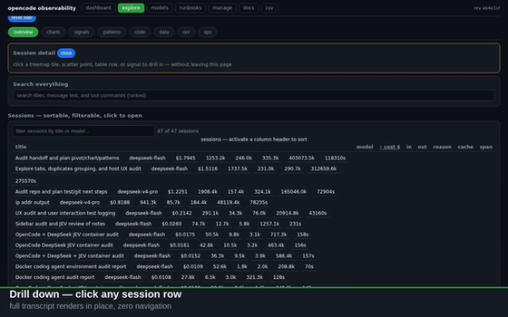](docs/ux/clip-drill.mp4)
[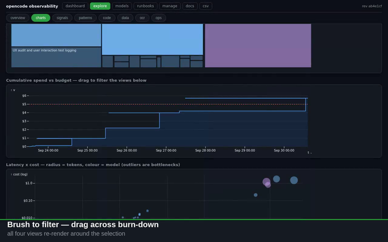](docs/ux/clip-brush.mp4)
[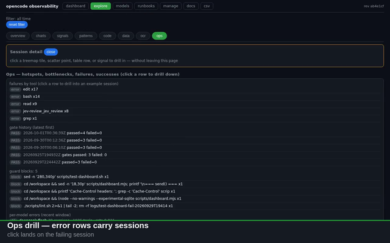](docs/ux/clip-ops.mp4)
[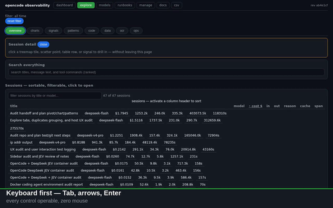](docs/ux/clip-kbd.mp4)
[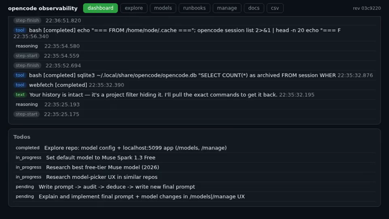](docs/ux/cdp-probe-tour.mp4)

Session-resume tour (33 s): when the upstream web UI cannot list old
sessions, resume via transcript — `docs/ux/resume-tour.mp4` demonstrates
the empty list, the data proof, the resume pointer, the agent
continuing, and two upstream API defects with repro lines.

CDP probe tour (36 s): the `:4096` → `:5099` chain made visible —
home sessions table (12 recent rows, live counts), the runbooks page
with the `cdp-probe` entry, then `/explore`. Captured with scripted
Playwright against this HEAD (rev banner on screen, no STALE flag):
`docs/ux/cdp-probe-tour.mp4`. Reproduce every frame from the terminal:

```bash
node scripts/cdp-tab.mjs --self-test                             # offline, 10 checks
node scripts/cdp-tab.mjs tabs                                     # live browser tabs
node scripts/cdp-tab.mjs openauth http://127.0.0.1:4096/session  # answer the login dialog
node scripts/cdp-tab.mjs probe                                    # PASS + logs/cdp/probe-latest.json
```

Why `openauth` exists: `:4096` is JavaScript Object Notation (JSON)-API-only
and answers browsers
with `401 + Basic realm` and an empty body, so an opened tab parks on
the login dialog with nothing to display. Answering the challenge
renders the session JSON in the tab (43 sessions); the human-readable
view of the same data stays `:5099`.

### Resume a session (read this — two stores exist)

The host TUI reads your **host-local** session store (2 sessions);
the `:4096` server holds **43 sessions** (counted 2026-10-03). A bare `opencode attach`
fails with `401 Unauthorized` because the server requires the
password and the command sends none — load it from `.env.local`
first (this prints nothing secret):

```bash
cd /home/owner/Documents/9e3e0363-0237-4c38-93dc-ce25e2f1ec37/repo
set -a; source .env.local; set +a
opencode attach http://localhost:4096 -s ses_f1d27512affeO4Z3ZoeWK9noI6
```

Variants: `--continue` resumes the last session, `--fork` copies
instead of continuing, `-p/-u` pass credentials explicitly (avoid:
they land in shell history). If the web UI shows "Nothing here yet"
or a deep link renders only the title, that is an upstream client
hydration gap, not data loss — verify with
`opencode session list` (local) vs `/api/session` (server), then
resume via transcript: start a new session and point it at
`logs/transcript-ses_f1d27512.md` (see `docs/ux/resume-tour.mp4`).

All shots captured with Playwright against a scratch dashboard build;
see `docs/ux/` for the files. The served revision banner (top right)
tells you whether you are looking at current code.

### 1. Dashboard — costs, sessions, live activity

Open `http://127.0.0.1:5099/`. The stat cards show total cost, session
count and token use; the sessions table (click a row) drills into one
session; live activity streams tool calls as they happen.

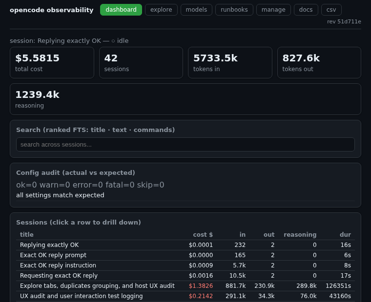

### 2. Explore — overview, charts, signals

`/explore` has seven tabs. The overview table sorts/filters all
sessions by cost and tokens:

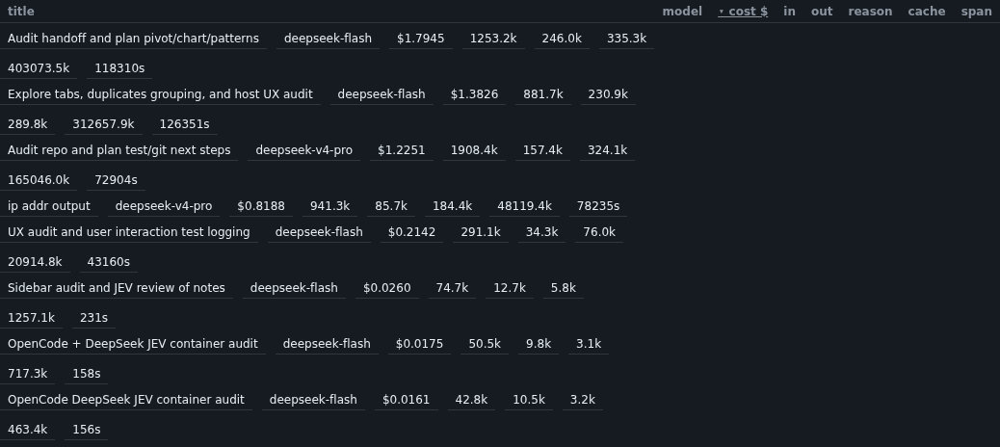

The charts tab carries cumulative spend (drag to brush-filter every
view below it), latency-x-cost scatter, token flow, sessions-over-time
and the word cloud:

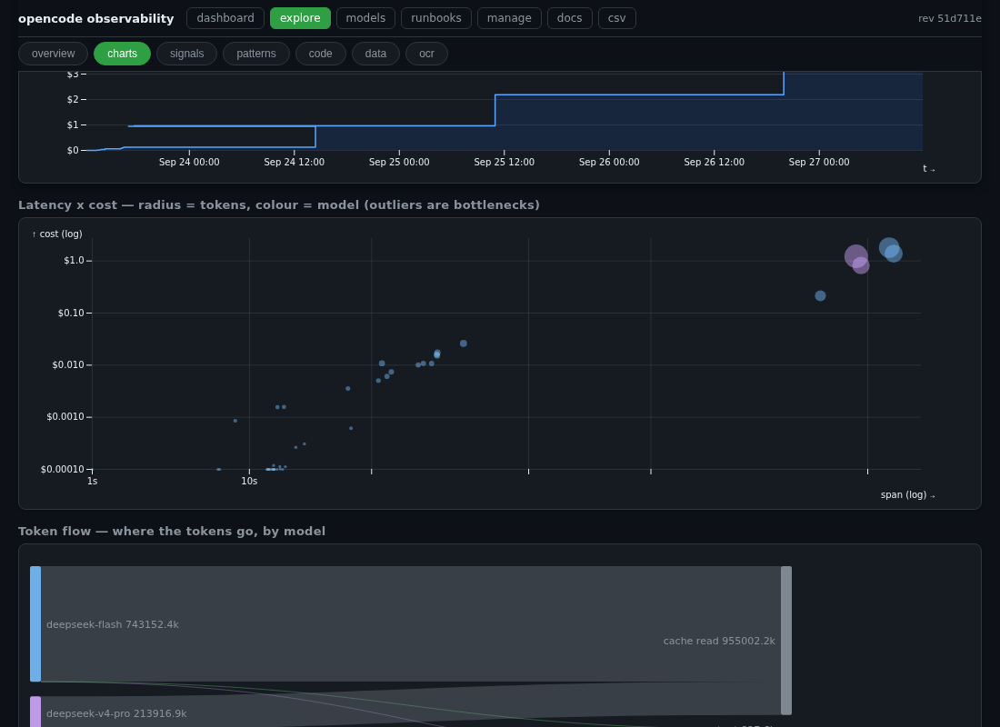

The signals tab adjudicates stalls against the live server — dead
findings are archival, not live stalls:

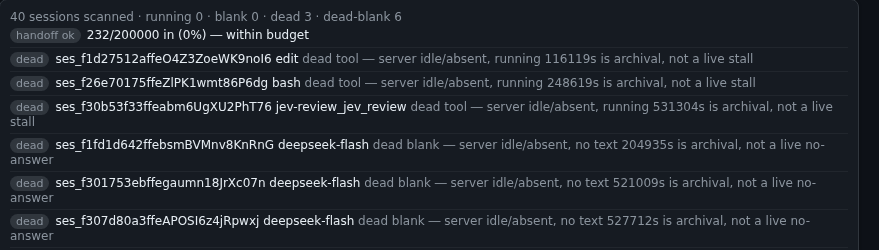

### 3. Runbooks — filter, read, copy

`/runbooks` lists the 19 operational runbooks with host/container
tags. Filter by tag, read the steps inline, copy commands with the
copy button. Async panels show a `loading...` skeleton while fetching,
never a blank shell:

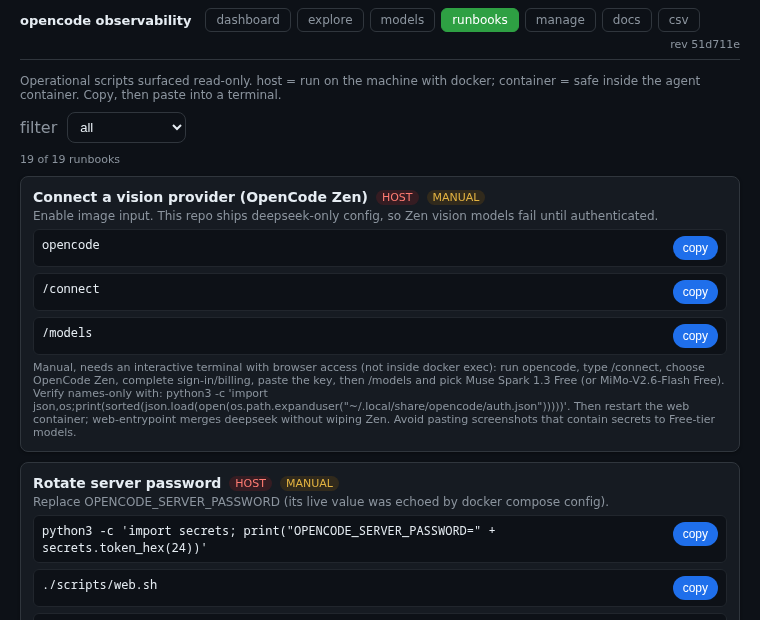
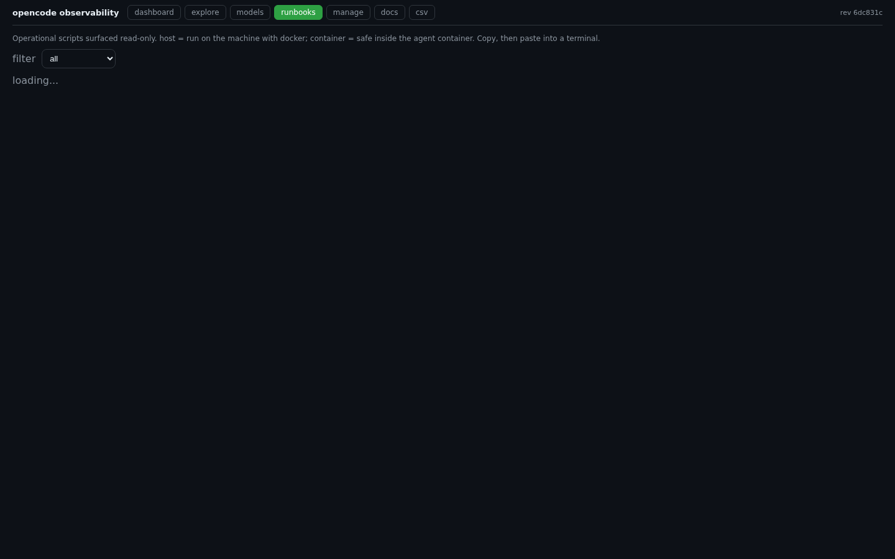

### 4. Models — catalog and policy

`/models` shows the model catalog, the cost policy verdict
(ALLOW/ASK/BLOCK) and per-model tool-error ledgers:

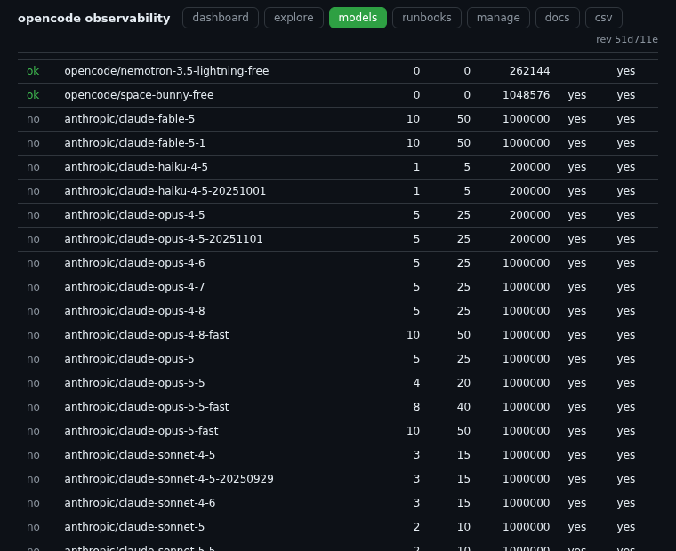

## Session health (stalls / blank turns)
The interactive web view can freeze ("Shell" stuck, blank message pane) while
the agent is not actually stalled; the server's store is still complete.
`scripts/session-health.mjs` reads data/opencode/opencode.db read-only and
reports two low-false-positive signals straight from the row log:

- running_tool — a tool part still state.status="running" past --run-ms
  (default 120s): the sharpest agent-stall fingerprint.
- blank_tail — a recent session whose last part is a tool with no text part
  after it: the "no answer printed" fingerprint.

It deliberately does NOT report long inter-part gaps: measured here they were
~100% overnight user-idle, and a noisy alert is worse than none ("cry wolf").
Served at /api/health and /explore ▸ signals; --live additionally reads
GET /session/status; --self-test runs offline on synthetic fixtures and is
gated in test-hygiene.sh. No model call, no browser.

The UI follows DESIGN.md: one accent (#2ea043), an 8px grid, Material
elevation on cards (rest on --e1, rise to --e2 on hover), 8px radius on
surfaces and 999px pills. The tokens + overrides live in `THEME_CSS` in
scripts/dashboard.mjs and are injected on every page.

## One command for the whole state
    ./scripts/harness.sh [--fast] [--export]

Runs every gate (lint, test-hygiene, test-patterns, test-dashboard), then the
live telemetry (guard actions + tool errors), the cost headline, the learned
rules, the model catalog, the doc budget and the TODO "in flight" list, and
prints a summary. `--fast` skips the slow dashboard gate; `--export` writes a
timestamped report to logs/; `--json` emits only
`{ts,rev,passed,failed,gates[]}` for a wrapper. Robust: a failing gate is
reported and the run continues.

The tooling's machine interfaces are contract-tested:

    ./scripts/test-tooling.sh     # every --json tool emits the keys callers read
    ./scripts/test-hygiene.sh     # runs test-tooling.sh too

test-tooling.sh proves preflight, doc-budget, learn-rules, issue-solutions,
audit-tool-calls, prompt-lint, models and logs emit parseable JSON with the
expected keys; it never calls harness.sh, so it cannot recurse.

The doc corpus that a session reads first (RULES/HANDOFF/README/TODO/DESIGN/
skills) is itself context cost:

    ./scripts/doc-budget.sh          # ~tokens + content hash; unchanged = cached

It records a hash in data/observability/docs.json, so an unchanged corpus means
nothing new to re-learn (the ECC external-skills-catalog context-budget /
content-hash-cache pattern).

Before spending on a session, run the fail-closed spend gate:

    ./scripts/preflight.sh          # exit 1 = do NOT spend until resolved

It checks keys, the last `harness.sh` gate result
(data/observability/last-gate.json), the DeepSeek balance (`MIN_BALANCE`,
default $1.00) and the model, and stops if any are wrong. Best practice for
"avoid API spend while a gate is red": gate on a cheap local signal, fail
closed, and capture `logs.sh` output before any retry so a retry is not blind.

"Laya before Jev" (self-hosted Laya first, hosted Jev on escalation) cuts
Jev/TypeSafe calls — small here (11 jev-review invocations total). It does not
cut DeepSeek: Laya is a Jev-compatible classifier, not a chat model. The big
lever is pinning `deepseek-flash` (v4-pro was 75% of spend).

## Verification status (2026-10-12, rev 338e142)

Sandbox-runnable gates, all green: `lint.sh` 177 pass, `test-hygiene.sh`
39 pass, `test-patterns.sh` 6 pass, `cdp-tab.mjs --self-test` 10/10,
`blacklist-guard-self-test` PASS, `ux-trace.py --self-test` 9/9,
`gate-all.sh` 15 pass / 0 fail / 1 skip (host-only probe/litellm).
Host-side `ux.sh status` (chrome + probe): `probe: PASS` — dash 79,
opencode 54, rendered 12 rows, browser 54/54, drift note by design.
Pages export (`pages-export.sh --shell`): 78 sessions, `site/index.html` +
`data.json` built; deploy stays manual (`workflow_dispatch`).

Second environment (2026-10-12): `.45` moved `belkin2` → Samsung Galaxy
hotspot. `dns-guard.sh` HEALTHY on the new uplink, `.24` stack re-probed
PASS unaffected (isolation proven), tailnet cross-plane 5–17ms 0% loss.
Same `docs/ux` shots below (refreshed 09:20 run).

## How-to guides

```bash
# PASS check (the whole state, one command)
bash scripts/ux.sh status
# Backup (atomic, Write-Ahead Logging (WAL)-safe) + verify
python3 -c "import sqlite3; s=sqlite3.connect('file:data/opencode/opencode.db?mode=ro',uri=True); print(s.execute('SELECT COUNT(*) FROM session').fetchone())"
# Cert rotate + trust (LAN SAN, then relaunch Chrome)
CERT_EXTRA_SANS="IP:192.168.4.24" ./docker/certs-init.sh && ./docker/certs-trust.sh
# DNS recovery (detect/record always; remediate only with --fix)
bash scripts/dns-guard.sh && bash scripts/dns-guard.sh --fix
# Uplink switch survival (.45 belkin2 → Galaxy proven 2026-10-12)
bash /tmp/dns-guard.sh && ping -c3 100.70.43.78
# Pre-push review (SKIP when reviewer absent) + redacted Pages build
bash scripts/ux.sh review && ./scripts/pages-export.sh --shell --yes --limit 500
```

### Hotspot roaming test (.45 → Samsung Galaxy, annotated)

On `.45`, switch the uplink, then prove the overlay outlives the LAN.
Copy `hotspot-test.sh` over first (`.45` has no repo checkout):
`scp owner@192.168.4.24:.../repo/scripts/hotspot-test.sh /tmp/` then
`bash /tmp/hotspot-test.sh`. What to press when:

| When | Press / run | Expect |
|---|---|---|
| Phone | Hotspot ON | `.45` joins new LAN |
| `.45` shell | `bash /tmp/hotspot-test.sh` | §1 DNS ok |
| Same run | (automatic) | §2 overlay `401` + `200`; §3 belkin URL times out (control) |
| Same run | (automatic) | §4 Pages `200`; §5 Chrome version or SKIP |
| `.45` Chrome | Open `https://10.100.0.24:4096/` → **accept** cert if asked → Basic login `opencode` → sessions render | Interactive UI on hotspot |
| Done | Paste the whole output back | Recorded as the next environment row |

Proven 2026-10-12: DNS HEALTHY, `.24` stack PASS unaffected, tailnet
5–17ms lossless, Pages reachable.

Hotspot anomaly under watch: from `.45`-on-Galaxy, Nebula `:5099`
answers `200` but `:4096/session` stalls past 10s with zero bytes while
the same endpoint is instant on-LAN. Small-response-OK vs
large-response-stall fits an MTU/PMTUD blackhole on the phone uplink
(Nebula runs mtu 1300; `/session` ships 54 sessions). Not yet proven —
re-run §2 on a quiet link and, if it persists, `tracepath 10.100.0.24`
from `.45` to find the clamping hop. The deduced-links panel this
motivates ships in the Pages build below.

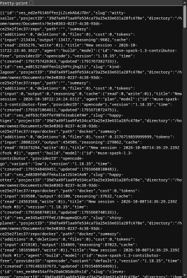
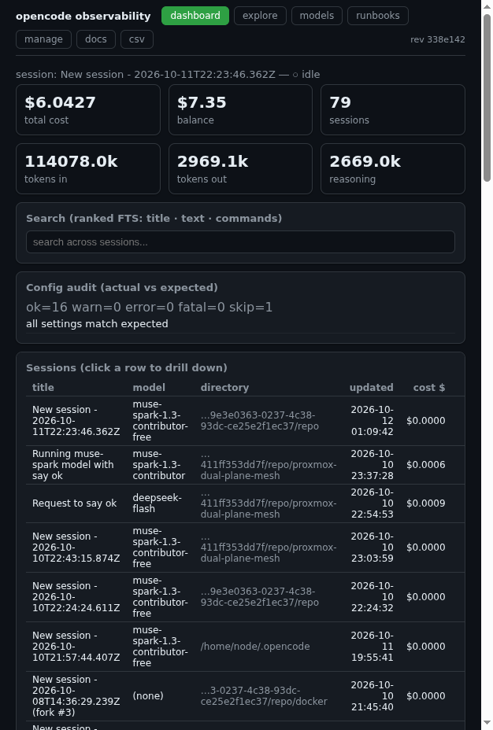

## Choosing a model
    ./scripts/models.sh              # catalog + cost policy verdict
    ./scripts/models.sh --write      # persist data/observability/models.json

Model choice is a policy, not a hard-coded name. models.policy.json sets the
ceiling (max_input_per_m_usd), the allow and deny lists; free models always
pass. The catalog (from `opencode models --verbose`) currently has 7 free Zen
models plus deepseek-flash and v4-pro. The verdict is ALLOW / ASK / BLOCK:
ASK means over policy but cheaper/qualified alternatives exist, so alert the
user rather than silently stop. The interactive chooser is the /models page in
the observer UI (dashboard · explore · models · runbooks · manage · docs · csv); switch
from the TUI with /models or `opencode run -m <id>`.

## Adding a provider (Google Gemini)
Gemini is not a native provider in this opencode build (`opencode models
google` → "Provider not found"), so it is wired exactly like DeepSeek: an
OpenAI-compatible provider block in opencode.json.

1. Create a key at https://aistudio.google.com/apikey.
2. Add `GEMINI_API_KEY=<key>` to .env.local (mode 0600). Compose passes it to
   the web container via `env_file` and to the TUI via the environment list.
3. Restart: `docker compose -f docker/docker-compose.yml restart opencode-web`.
4. `./scripts/models.sh --write && ./scripts/preflight.sh`.
5. Select it: `/models` (TUI) or `opencode run -m gemini/gemini-2.5-flash`.

The block points at https://generativelanguage.googleapis.com/v1beta/openai/.
`gemini-2.5-flash` and `gemini-2.5-flash-lite` are allow-listed in
models.policy.json (Flash input ~$0.30/1M is above the $0.20 ceiling, so it is
explicitly allowed). The same steps are a "connect-gemini" runbook at /runbooks.

## Configuration reference (all tunable settings)

Default model: `opencode.json` field `"model": "deepseek/deepseek-flash"`.
Change it for one run (`opencode run -m <id>`), interactively (`/models`
in the TUI), or permanently (edit the field, restart the server).

`.env.local` keys (mode 0600, never printed; values with shell
metacharacters must be single-quoted or `source` aborts partway):

- `DEEPSEEK_API_KEY` — execution model billing.
- `JEV_API_KEY` — Jev review MCP + guard plugin auth.
- `GEMINI_API_KEY` — optional second provider (placeholder ok if unused).
- `OPENCODE_SERVER_PASSWORD` — Basic auth for :4096 and the dashboard.
- `LITELLM_MASTER_KEY` — LiteLLM proxy admin (generated on setup).

Ports (all loopback-only): `4096` opencode web/API, `5099`
observability dashboard (override with `DASH_PORT`), `4000` LiteLLM
proxy. Test scratch ports default to 5196+ (`TEST_DASH_PORT`).

Performance TTLs (env overrides, defaults in parentheses): cache
freshness windows, not correctness knobs — raise them to trade
staleness for less recompute: `HEALTH_TTL_MS` (15000),
`POLL_TTL_MS` (10000), `CACHE_TTL_MS` (15000), `SIGNALS_TTL_MS`
(30000); per-model ledger is fixed at 60 s. `QUERY_WORKER_PATH`
overrides the aggregation worker entry (fault-injection seam);
`LEDGER_DB` overrides the event-ledger path (test seam).

Budgets: `models.policy.json` gates model choice pre-flight
(deny-list wins); `docker/litellm.config.yaml` `max_budget: 5.0`
covers proxy-routed traffic only, and is unenforced without
`DATABASE_URL` — direct `api.deepseek.com` callers bypass it.

## Working process (project skill + command)
.opencode/skills/jev-harness/SKILL.md is auto-loaded by opencode and codifies
the loop for this repo: search-first (read HANDOFF/RULES/TODO + run preflight),
respect the enforced blacklist, keep the model on policy, gate every change
with harness.sh, learn from the corpus, and keep the docs current. Adapted from
the ECC agent-harness pattern (github.com/affaan-m/ECC); do not stack a full
ECC install on top of it. See HANDOFF.md "ECC skills (audit)".

The recurring "list outstanding issues + implement the doable queue" prompt is
a command, not a paste: run /status (`.opencode/command/status.md`). It lists
issues in both senses, classifies work A local-now / B needs-host / C larger /
D external, implements one doable segment, gates, and records a reason on each
deferral — so a request that is impossible or ballooning is named, not half-done.

Visual exploration lives at /explore (/viz 302-redirects there): a tabbed
database tool (overview · charts · signals · patterns · code · data · ocr) —
ranked search, a sortable sessions table, duplicate grouping, the DB map,
integrations, the A/B panel, patterns + known fixes, signals + guard +
session-health, and the charts. d3 v7.9.0 and d3-sankey v0.12.3 are vendored
under scripts/vendor/ and served at /vendor/*.js (offline, pinned). Full list:
HANDOFF "Navigating the observability UI".

The headless UI test (test-dashboard-ui.mjs) resolves element ids strictly (an
id absent from the served HTML is null, as in a browser) — which caught the
missing `#tabs` id that made the page dead.

Host-only UX tools (Playwright; run as `python3 scripts/…` from the repo root):
`ux-audit.py [url]` (height, panel counts, tab toggle, page errors, screenshot),
`ux-test.py [url]` (assertions; `--check` prerequisites; SKIP not PASS when
absent), `ux-trace.py [url]` (records every click/drag/scroll + hotspots into
`data/observability/ux.db` + `logs/ux/report.md`; `--ocr` reads each shot back
to text; `--self-test` offline). `node scripts/cdp-tab.mjs` (live-browser
CDP: tabs/open/text/eval/shot/openauth/probe; `--self-test` offline).
Runbooks: "ux-test", "ux-trace", "cdp-probe" (host).

## Search from the terminal
    ./scripts/semantic-search.sh <query...>     # ranked, across sessions
    ./scripts/semantic-search.sh --rebuild      # rebuild the on-disk index
    ./scripts/semantic-search.sh --fuzzy <q...> # typo-tolerant ("edti" -> "edit")

Builds a persistent FTS5 index at data/search/opencode-index.db (gitignored)
and prints bm25-ranked hits with snippets. Same index the dashboard serves
from memory; this on-disk copy is the substrate for a future Laya/Jev
semantic reranker. `--fuzzy` (or `fuzzy-search.py`) adds a local `difflib`
rerank over the index so a mistyped token still finds the right material.

## Cost bottlenecks
    ./scripts/cost-bottlenecks.sh [--top N]

Ranks the cost drivers in the database: effective $/1k-input, top sessions
by cost and by input tokens, worst effective $/1k-input, tiny-session
overhead, per-model cost share, a "model mix check" that flags any spend
outside the `deepseek-flash` default, and a prompt cache-hit report
(cache-read vs fresh input; 99.0% overall here). Read-only; host or container.
It also prints a "context budget (latest session)" line (`CONTEXT_BUDGET`,
default 200k input tokens); `opencode.json` sets `compaction` (auto + prune,
`tail_turns: 20`) to bound replayed context.

## Session database & tool-use methods
Everything the agent does — including every tool call — is one SQLite
database at data/opencode/opencode.db. The dashboard and scripts read it
read-only (node:sqlite / --experimental-sqlite); nothing is ever written
back. Tables that matter:

    session    one row per session (title, cost, tokens_*, model, times)
    message    one row per turn (data.role)
    part       one row per message part — the granular event log
    todo       the live plan (content, status, priority, position)

A tool call is a `part` row whose `data` is JSON:

    {"type":"tool","tool":"bash",
     "state":{"status":"running|completed|error",
              "input":{"command":"...","filePath":"..."}}}

so the ordered tool sequence for a session is

    SELECT json_extract(data,'$.tool') FROM part
    WHERE session_id=? AND json_extract(data,'$.type')='tool'
    ORDER BY time_created;

and a corpus-wide n-gram count is a single window query (lead() over
PARTITION BY session_id). ./scripts/test-patterns.sh proves this substrate
read-only (tool parts, distinct tools, bigrams, error chains) and gates the
deferred "patterns view" candidate.

## Next candidates (deferred, not started)
   1. finos/perspective pivot grid    new /explore tab (vendored like d3)
   2. Observable Plot / Vega-Lite     declarative charts (largest refactor)
   3. Patterns view (tool-sequence    /api/patterns + /explore tab, mined
      n-grams)                        from `part` tool sequences

Attack order: 3 → 1 → 2. See HANDOFF.md "Next candidates" for the scope,
and HANDOFF-PROMPT.txt for the verbatim prompt to paste into the next
session.

## Jev functional proof
    ./scripts/test-jev-functional.sh

Invokes the jev-review MCP tool for real and fails (non-zero) unless the
tool fires and returns at least one applicable metric with a score. Runs
from the host. doctor.sh --full (Tier 9) runs it automatically.

## Image tooling
The image includes python3 and sqlite3 (docker/Dockerfile apt install).
The database lives at data/opencode/opencode.db, mounted from
../data/opencode into the container. The base image is pinned by digest
and the opencode installer is pinned to 1.18.32 for reproducible builds.

## Two modes (operator vs. agent)
There are two distinct surfaces and the scripts do not cross over.

    Operator (host terminal)     docker, docker compose, the scripts
                                 under scripts/ that call docker.

    Agent (browser UI, 4096)     edits /workspace, runs opencode run,
                                 calls DeepSeek/Jev. No docker inside.

Do not paste host-script paths into the browser chat; the agent's shell
has no docker. To verify the agent's environment from inside the
container, run:

    ./scripts/verify-from-inside.sh [--full]

To confirm a session streams into the sidebar while it processes:

    ./scripts/test-sidebar-streaming.sh [--insecure]

## Troubleshooting
Scheme mismatch: plain `http://` on a TLS port answers `Client sent an HTTP
  request to an HTTPS server` — always use `https://` (there is no
  same-port redirect by design; the TLS listener owns 4096/5099).
  Drill-down silent on slow links: detail fetches are bounded at 60 parts
  (full transcripts via the txt/md/json download links); right-click has
  no "open link" because rows drill via JS, not anchors.
EACCES on /workspace: host UID mismatch. Script uses --user $(id -u).
HTTP 401 from DeepSeek: verbatim body printed by the script.
HTTP 422 from TypeSafe: request body format issue.
docker build permission denied: add user to docker group.
Smoke test FAIL despite OK response: known opencode exit-code bug.
  Script asserts on text, not exit code, to work around this.
Silent stall during smoke test: process substitution ensures live
  streaming. If this recurs, check that bash is version 4+ (process
  substitution is a bash feature).

## References (links verified 200 on 2026-09-30)

Specs/standards: W3C Accessible Rich Internet Applications (ARIA) Authoring
Practices Guide (APG) tabs
https://www.w3.org/WAI/ARIA/apg/patterns/tabs/ · Web Content Accessibility
Guidelines (WCAG) 2.1
https://www.w3.org/TR/WCAG21/ · RFC 5861 stale-while-revalidate
https://httpwg.org/specs/rfc5861.html · Go singleflight
https://pkg.go.dev/golang.org/x/sync/singleflight · CSP3 script-src
https://www.w3.org/TR/CSP3/ · SQLite WAL https://www.sqlite.org/wal.html ·
JSON1 https://www.sqlite.org/json1.html · window functions
https://www.sqlite.org/windowfunctions.html · FTS5+BM25
https://www.sqlite.org/fts5.html

API/library docs: Observable Plot https://github.com/observablehq/plot ·
d3-brush https://github.com/d3/d3-brush · d3-sankey
https://github.com/d3/d3-sankey · LiteLLM retries
https://docs.litellm.ai/docs/completion/reliable_completions · budgets
https://docs.litellm.ai/docs/proxy/virtual_keys · DeepSeek JSON mode
https://api-docs.deepseek.com/guides/json_mode · Meta structured output
https://ai.developer.meta.com/docs/features/structured-output · Playwright
evaluating https://playwright.dev/docs/evaluating · opencode CLI
https://dev.opencode.ai/docs/cli · opencode MCP
https://opencode.ai/docs/mcp-servers · GitHub Representational State Transfer
(REST) pagination
https://docs.github.com/en/rest/using-the-rest-api · Stripe pagination
https://stripe.com/docs/api/pagination

Books (ISBNs): Raymond, The Art of Unix Programming (AW, 2003, 978-0131429017)
— clarity/pasteability, §1.6.2. Kleppmann, Designing Data-Intensive
Applications (O'Reilly, 2017, 978-1449373320) — derived-data caching, ch. 11.
